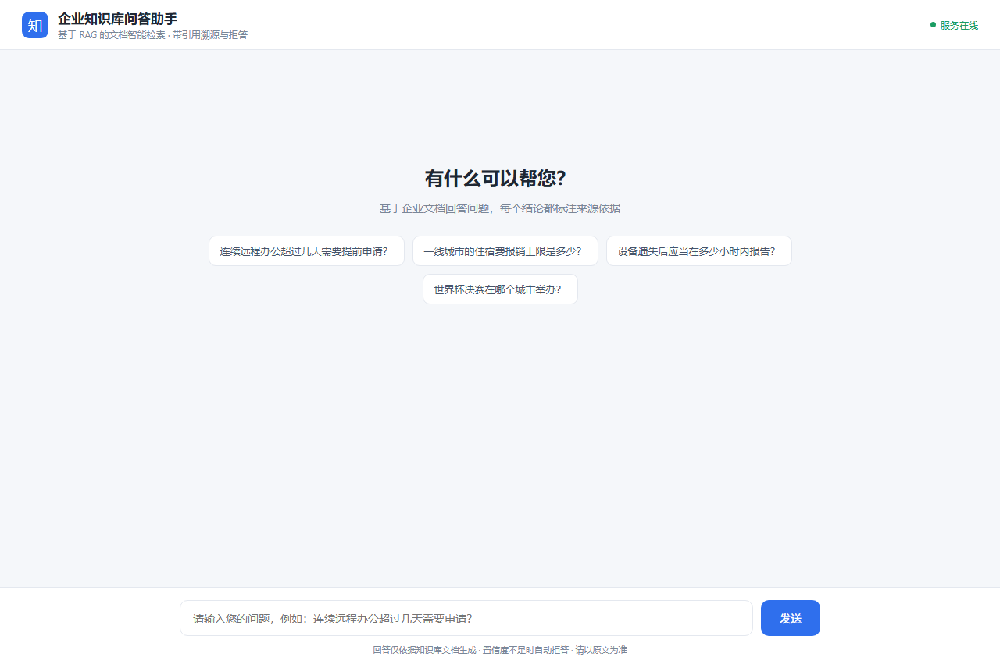
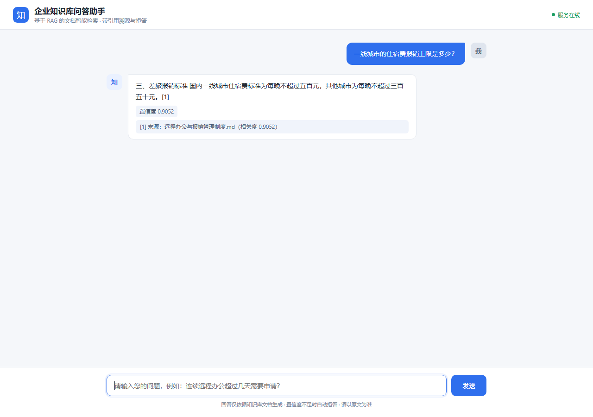
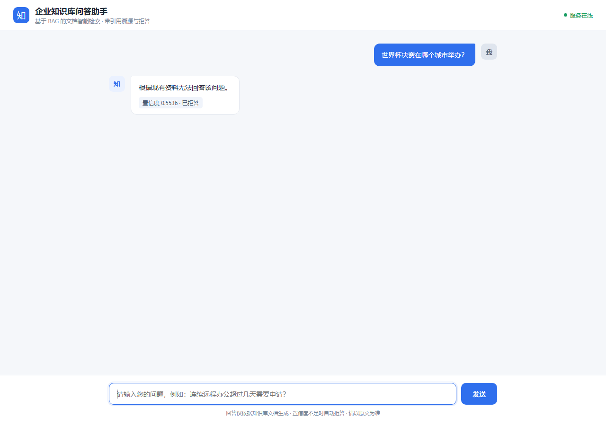

# 企业知识库 RAG 问答系统

一个用纯 Python 代码实现的 RAG 全链路项目：文档解析 → 分块 → 混合检索 → 带引用生成 → 评估 → 服务化部署。默认使用离线可复现的 demo 模式，**无需 API Key 即可跑通**。

## 亮点

- **大模型工程化**：统一的 LLM 适配器（OpenAI 兼容协议），可接 OpenAI / DeepSeek / 通义 / 智谱 / 本地 Ollama，切换模型不改业务代码；
- **大模型核心技术**：流式输出（streaming）、结构化 JSON 输出（structured output）、上下文预算与 token 管理、多轮对话、Prompt 工程与幻觉抑制；
- **混合检索**：Chroma 向量召回 + BM25 关键词召回，归一化加权后重排序；
- **引用溯源与拒答**：每个事实性句子带来源编号，置信度不足时拒答，保留人工确认边界；
- **完整评估体系**：内置 10 条评估集与 6 项指标，一条命令输出结构化报告；
- **可部署**：FastAPI 服务 + Docker Compose，附带可直接使用的 Web 聊天界面。

> 大模型技术点、代码位置与切换真实模型的方法，详见 [docs/大模型技术应用说明.md](docs/大模型技术应用说明.md)。

## 效果演示

服务自带 Web 聊天界面，启动后访问 `http://127.0.0.1:8000/` 即可使用。以下截图为实际运行效果（demo 模式，无 API Key）。

**问答首页** — 内置四个示例问题，覆盖精确数字题与越界题：



**带引用的回答** — 每个事实性结论标注来源文件与相关度分数，答案只依据知识库文档生成：



**拒答边界** — 知识库中没有相关信息时明确拒答，不编造内容：



## 快速开始

```bash
pip install -r requirements.txt
python main.py init --reset          # 建索引（示例文档）
python main.py ask "连续远程办公超过几天需要申请？"
python main.py eval                  # 跑评估集
python main.py serve                 # 启动服务
```

服务启动后，浏览器打开 `http://127.0.0.1:8000/` 使用 Web 问答界面；`http://127.0.0.1:8000/docs` 查看 API 文档。也可以用 curl 直接调接口：

```bash
curl -X POST http://127.0.0.1:8000/ask -H "Content-Type: application/json" -d "{\"question\":\"一线城市住宿费上限是多少？\"}"
```

> **在 PyCharm / VS Code 中运行时注意**：`main.py` 是命令行入口，必须带子命令。直接点 IDE 的 Run 按钮等于执行 `python main.py`，会提示缺少 command。请在 IDE 内置 Terminal 里执行上面的命令，或在 Run/Debug Configurations 的 Script parameters 里填写 `serve`（或 `init --reset`）。
>
> 另外，`data/chroma_index/` 已被 `.gitignore` 排除，从 GitHub 下载的代码**没有索引**，首次必须先执行一次 `python main.py init --reset`。

## 切换到真实大模型

默认 `hash + mock` 只是为了让链路在无 Key 环境可跑；**所有真实大模型能力都已实现**，改环境变量即可启用，业务代码零改动。

**方案 A：本地私有化（Ollama，无需 API Key）**

```bash
pip install -r requirements-optional.txt
ollama pull qwen2.5:3b
set EMBED_MODEL=sentence-transformers
set LLM_MODE=ollama
set OLLAMA_MODEL=qwen2.5:3b
python main.py init --reset
python main.py serve
```

**方案 B：国产模型 API（以 DeepSeek 为例，通义/智谱/Moonshot 同理）**

```bash
set LLM_MODE=openai
set OPENAI_BASE_URL=https://api.deepseek.com/v1
set API_KEY_ENV=DEEPSEEK_API_KEY
set LLM_MODEL=deepseek-chat
set DEEPSEEK_API_KEY=你的key
python main.py serve
```

**方案 C：OpenAI**

```bash
set LLM_MODE=openai
set OPENAI_API_KEY=你的key
python main.py serve
```

切到真实模型后，Web 界面的回答会自动变成大模型生成的结果，截图即可重截。Linux/macOS 把 `set` 换成 `export`。完整说明见 [docs/大模型技术应用说明.md](docs/大模型技术应用说明.md)。

## 评估集与指标

`evaluation/qa_dataset.jsonl` 每条包含 question / relevant_sources / reference / should_refuse。
`python main.py eval` 计算 Recall@k、Precision@k、MRR、Faithfulness、Answer Relevancy、Refusal Accuracy，报告写入 `evaluation/last_report.json`。

指标是工程可用的简化实现，不是 RAGAS 完整版；定义、局限与调参方法见 `docs/评估方法说明.md`。

## API 接口

服务启动后访问 `/docs` 查看完整 Swagger 文档。核心接口：

| 接口 | 方法 | 说明 |
|---|---|---|
| `/ask` | POST | 标准问答，支持 `history=true` 启用多轮对话 |
| `/ask/stream` | POST | 流式问答，逐块返回大模型输出 |
| `/structured` | POST | 结构化输出，返回可解析的 JSON |
| `/conversation/reset` | POST | 清空多轮对话历史 |
| `/ingest` | POST | 文档入库建索引 |
| `/evaluate` | POST | 跑评估集并返回指标 |
| `/health` | GET | 健康检查与当前模型配置 |

## 目录结构

```text
ingest/       文档解析、清洗、分块、入库
retrieval/    Embedding、BM25、混合召回、重排序
generation/   Prompt、LLM 适配、流式/结构化输出、上下文工程、多轮对话、拒答
evaluation/   评估集、指标、批量评估
api/          FastAPI 服务与 Web 聊天界面（api/static）
deploy/       Dockerfile 与 docker-compose
docs/         架构、大模型技术、评估、面试问答、效果截图
data/         示例文档与索引
tests/        核心逻辑单测
```

Web 界面支持 URL 参数 `?demo=0~3` 自动发起对应示例问题，方便快速演示或复现截图。

## 测试

```bash
python -m unittest discover -s tests -v
```

## 设计说明

- 为什么默认 hash + mock：让全链路在无网络、无 Key、无显卡环境可跑、可测、可复现；换真实模型只改环境变量。
- 为什么混合检索：向量补语义，BM25 补数字与专有名词的精确匹配。
- 为什么保留拒答：AI 应用落地时，知道什么时候不回答，比多回答一句更重要。

详细追问与回答口径见 `docs/面试问答.md`。
